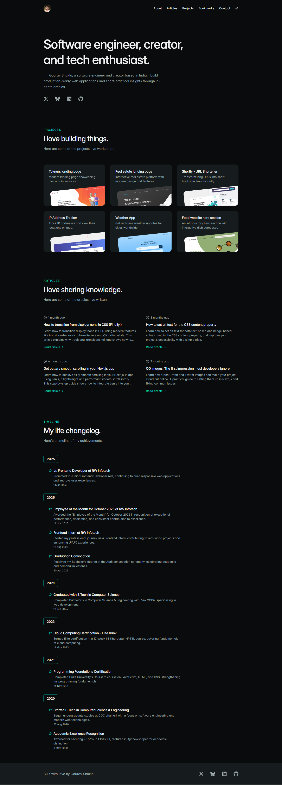

# Personal Site

My personal site with a blog, projects, bookmarks, and an about page. Content is managed in Sanity.

- **Live:** [gshukla.in](https://gshukla.in)
- **Studio:** [`apps/studio`](../studio)
- **Monorepo setup:** see the [root README](../../README.md)



## Stack

- [Next.js 16](https://nextjs.org) (App Router)
- [React 19](https://react.dev)
- [TypeScript](https://www.typescriptlang.org)
- [Sanity](https://www.sanity.io) with [Portable Text](https://github.com/portabletext/react-portabletext)
- [Shiki](https://shiki.style) for syntax highlighting
- [Sass](https://sass-lang.com) modules
- [Base UI](https://base-ui.com)
- [next-themes](https://github.com/pacocoursey/next-themes)
- [Lucide React](https://lucide.dev)

## Getting Started

Requires Node.js 24+ and pnpm. From the repository root:

```sh
pnpm install
pnpm dev --filter=frontend
```

Open [http://localhost:3000](http://localhost:3000).

| Command      | Description          |
| ------------ | -------------------- |
| `pnpm dev`   | Start the dev server |
| `pnpm build` | Build for production |
| `pnpm start` | Serve the build      |
| `pnpm lint`  | Run ESLint           |

## Environment Variables

Create `apps/frontend/.env.local` if needed:

```env
NEXT_PUBLIC_BASE_URL=https://www.gshukla.in
SANITY_REVALIDATE_SECRET=your_webhook_secret
```

- `NEXT_PUBLIC_BASE_URL`: optional, used in the sitemap and robots.txt.
- `SANITY_REVALIDATE_SECRET`: required in production to verify Sanity webhooks.

## Content Revalidation

Pages are cached and refreshed when content is published. Add a Sanity webhook with:

- **URL:** `https://www.gshukla.in/api/revalidate`
- **Trigger on:** create, update, delete
- **Projection:** `{_type}`
- **Secret:** same value as `SANITY_REVALIDATE_SECRET`

Cached data also refreshes hourly as a fallback.

## Author

- **Website:** [gshukla.in](https://gshukla.in)
- **GitHub:** [@heygauravshukla](https://github.com/heygauravshukla)
- **Twitter/X:** [@heygauravshukla](https://twitter.com/heygauravshukla)
